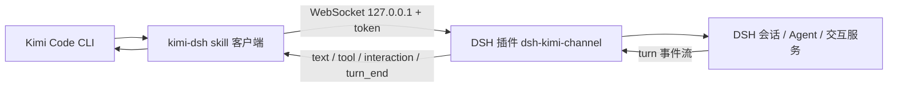

# Kimi Code 驱动 DSH 的通道插件 设计说明

**状态**：Draft · **日期**：2026-10-30 · **关联**：无

## 1. 背景与目标

**现状 / 问题**：目前让 Kimi Code 使唤 DSH 只有 `dsh --profile headless "<task>"` 一条路。它能拿到最终答案，也能用 `--json` 看工具调用，但拿不到三样东西：审批交互（无人值守会卡住）、中途插话（没有 steer 通道）、完整轨迹（`--json` 是投影，单条事件 8 KiB 截断）。反过来，DSH-IM 这类插件能从微信、Telegram 直接操作会话、代答审批、流式回传，说明 DSH 内部本来就有一条完整的控制通道，只是没有对编程客户端开放。

**目标**：

1. Kimi Code CLI 可以创建或恢复一个 DSH 会话，下发任务，实时收到文本、思考、工具调用事件的流式推送。
2. Kimi Code 可以应答 DSH 的审批和提问，不需要人工在 DSH 界面点。
3. Kimi Code 可以中途 steer 或 abort 正在跑的轮次。
4. 任务结束时返回完整轨迹，不是截断的摘要。
5. 单机部署，不开放公网端口，权限与 DSH Web UI 同级。

**非目标**：

1. 不做通用 ACP 客户端，不替代 `@deepseek-ai/dsh-subagent-acp`。
2. 不改 DSH 核心包，只作为 profile 插件安装。
3. 不支持多用户、多租户、远程公网接入。
4. 不做跨版本协议兼容承诺，DSH 插件 API 目前未稳定。

**约束**：

1. DSH 插件 API 处于 0.2.x 预览期，破坏性变更可预期。
2. Kimi Code CLI 侧只能通过 shell 和 Skills 扩展，不能改它的源码。
3. 本机单用户，DSH 与 Kimi Code 在同一台机器。

## 2. 方案概览

**一句话方案**：写一个 DSH 宿主内插件，在本机回环地址起一个带 token 鉴权的 WebSocket 服务，把外部客户端的指令映射到 DSH 的会话、轮次和交互接口，再由 Kimi Code 侧一个 skill 客户端把结果流式取回。

**关键取舍**：

1. 选宿主内插件，不选 ACP。ACP 服务端刻意不提供交互 UI 能力，拿不到审批和 steer；插件跟 Web UI 同级，能力最全。代价是跟 DSH 版本强耦合，必须装进 profile。
2. 选 WebSocket 回环，不选公网中转。省掉中继服务和鉴权体系，代价是只能同机使用。跨机器需求留给后续的 AI Office 类 outbound 连接器。
3. 自己定义精简协议，不复用 dsh-im 的内部投递接口。dsh-im 的 adapter 是私有实现，协议跟着它变会绑死；自建协议只依赖 DSH 的会话和事件 seam。

## 3. 关键设计点

### 3.1 通道协议

- **做什么**：JSON over WebSocket，请求、响应、通知三类帧。方法集固定为 `session.ensure`、`prompt.submit`、`prompt.steer`、`prompt.abort`、`interaction.respond`、`state.snapshot`、`events.resume`。每个请求带客户端生成的 `id` 做幂等；每条事件带单调 `seq`，断线后可以从 `since` 续订。
- **为什么**：Kimi Code 侧要能用几十行脚本实现，不能要求它理解 DSH 的内部 RPC；幂等 id 和 seq 是断线重连和重复提交的最小必要机制。
- **怎么验证对**：同一 `id` 重复提交只产生一条用户消息；断线重连后 `events.resume(since=N)` 拿到的 seq 连续且无重复。

### 3.2 会话与轮次映射

- **做什么**：按 `conversationKey` 维护一个 DSH session（首次 `session.ensure` 时创建，带 `cwd`；后续复用）。收到 `prompt.submit` 后把文本作为用户消息提交给 agent，订阅该 session 的轮次事件，投影成通道事件：`text`、`thinking`、`tool_call`、`tool_result`、`interaction`、`turn_end`、`error`。`turn_end` 之后把本轮完整轨迹（含工具输入输出）压成一条 `final` 通知。
- **为什么**：Kimi Code 需要的是“看得懂的过程”，不是 DSH 原始日志；投影层负责把实现细节挡在协议外，也方便后续换协议版本。
- **怎么验证对**：一轮含 3 次工具调用的任务，事件序列里 3 个 `tool_call` 和 3 个 `tool_result` 一一对应，`turn_end` 只出现一次，`final` 里的轨迹条数与事件条数一致。

### 3.3 审批代答与安全边界

- **做什么**：插件收到 `interaction` 事件时转发给客户端，等待 `interaction.respond`，超时按拒绝处理。默认策略是只自动批准白名单里的只读工具（读文件、搜索、列目录），写文件和命令执行一律回给客户端决策。服务只绑 `127.0.0.1`，token 存 `~/.dsh/` 下权限 0600 的文件，连接时校验来源与 token，拒绝非回环来源。
- **为什么**：审批是这个方案存在的核心理由，也是最危险的一环。默认放开等于把任意命令执行权交给一个脚本，默认全拒又会让任务频繁卡死，所以采用按工具类别的分级策略。
- **怎么验证对**：白名单工具无人工介入自动通过；写文件操作在客户端不应答时超时被拒并让轮次以明确原因结束；从非回环地址连接一律 401。

## 4. 接口与数据

- **对外可见变更**：新增一个 profile 插件 `dsh-kimi-channel`，通过 `dsh plugin add` 安装；新增配置文件 `~/.dsh/kimi-channel.json`（端口、token 路径、审批白名单）。DSH 的命令行和 Web UI 行为不变。
- **内部协议 / 数据结构**：协议版本 `v1`，帧类型 `req` / `res` / `evt`；事件类型如上。会话映射表持久化在插件数据目录，键为 `conversationKey`，值为 `{ sessionId, cwd, createdAt }`。
- **兼容与迁移**：不改 DSH 核心，不写已有配置文件；卸载插件即恢复原状。协议版本升级时旧客户端连上来直接返回明确的版本不匹配错误，不做静默降级。

## 5. 测试与验证

| 层次 | 用例 / 方法 | 验收口径 |
| --- | --- | --- |
| 单元 | 协议校验、幂等 id、seq 连续性、审批超时 | 非法帧被拒且不断连接；重复提交只落一条消息 |
| 集成 / 端到端 | 起 DSH 加插件，脚本跑一轮“读两个文件并改一个文件”的任务 | 审批按白名单分流；`final` 轨迹完整；会话可再次复用 |
| 对照 | 同一任务分别用 headless 和通道插件跑 | 通道版能完成需要审批的任务，headless 版会卡住；记录两者耗时与 token 消耗 |
| 回归 | 不装插件时 headless、Web UI 正常 | 启动无报错，行为不变 |

## 6. 风险与回退

| 风险 | 影响 | 触发条件 | 应对 / 回退 |
| --- | --- | --- | --- |
| DSH 插件 API 变更 | 插件加载失败或行为异常 | DSH 升级到新版本 | 锁定 DSH 版本；插件与 DSH 版本一起升；禁用插件回到 headless |
| 审批策略误放行 | 未授权写操作或命令执行 | 白名单配置过宽或匹配逻辑有洞 | 默认白名单只读；写操作强制人工；保留审批审计日志；一键禁用插件 |
| 本地端口被本机其他进程利用 | 等同 Web UI 权限被接管 | token 泄露或鉴权被绕过 | 只绑回环、token 0600、每次启动轮换；异常连接记日志 |
| Kimi Code 侧脚本解析失败 | 任务中断，用户看不到结果 | 协议不匹配或事件过大 | `final` 兜底为纯文本摘要；脚本失败时回退到 headless |
| 长任务超出 Kimi Code 单轮超时 | 任务被中断 | 工具调用密集或模型慢 | 客户端支持 `events.resume` 重连；把长任务拆成多次 `prompt.submit` |

## 7. 待决问题（已决）

- [x] **Q1** 用哪个内部 seam 驱动 agent｜**决策**：`ctx.agents.create / resume`（AgentFactory）拿 Agent，`agent.followup / steer / cancel` 驱动轮次，事件订阅 `session/event`，另外订阅 `agent/assistant-stream`（可选增量）、`agent/status`、`agent/error`。审批与提问走 `approval/request` 与 `user-questions/request` 两个瀑布事件。不复用 dsh-im 的 Host RPC 网关。依据：`@deepseek-ai/dsh-acp` 的 `AcpSession` 就是这套最小依赖面，说明它能支撑外部客户端完整的建会话、下发、取消、收事件流程。
- [x] **Q2** 是否复用 dsh-im 的 delivery adapter 抽象｜**决策**：不复用。dsh-im 是第三方插件，其 delivery adapter 与 Host RPC 是私有实现，跟着它升级会把协议绑死；自建协议只依赖上述公开 seam。
- [x] **Q3** 首版是否支持多会话并发｜**决策**：协议按 `conversationKey` 隔离，一个 key 一份会话映射，可同时存在多个 key；单个 key 内的轮次仍是串行（`prompt.submit` 进 inbox 排队）。并发轮次控制留到第二版。
- [x] **Q4**（实现期新增）通道创建的 agent 怎么拿到工具｜**决策**：必须像 Web 宿主一样挂 Agent 预设（`ctx.get('agentPresets').resolve(...)` 后 `mount(agentCtx, id)`，并把 preset id 写进 session meta）。只调 `ctx.agents.create` 不挂预设时，agent 只有 root 工具（`working_directory`），没有 fs / bash，任务会直接失败。预设通过 `agentPreset` 配置项指定，留空用注册表默认值。

## 8. 实现映射

代码在 `kimi-channel/`（宿主插件）与 `kimi-skill/dsh-channel/`（Kimi 侧 skill 客户端）。

| 设计点 | 实现位置 | 备注 |
| --- | --- | --- |
| 回环 WebSocket + 鉴权 | `kimi-channel/lib/ws.mjs`、`lib/token.mjs`、`lib/channel.mjs` | 自实现 RFC6455 子集，零依赖；只绑 `127.0.0.1`，token 文件 0600、启动轮换 |
| 协议帧与错误码 | `kimi-channel/lib/protocol.mjs` | `v1`，`req/res/evt` 三类帧，封闭错误码集合 |
| 会话映射持久化 | `kimi-channel/lib/store.mjs`、`~/.dsh/kimi-channel-sessions.json` | `conversationKey -> {sessionId, cwd, createdAt}`，原子写、0600 |
| 会话与轮次驱动 | `kimi-channel/lib/channel.mjs` | `ctx.agents.create/resume` + `agent.followup/steer/cancel`，挂预设 |
| 事件投影 | `kimi-channel/lib/projection.mjs` | `turn/start`、`assistant/message`、`tool/call`、`tool/result`、`turn/end` 投影为 `text/thinking/tool_call/tool_result/turn_end/final` |
| 审批与提问代答 | `kimi-channel/lib/interactions.mjs` | 白名单自动放行，其余转发客户端；超时或断连按拒绝/委派处理 |
| 断线续订 | `lib/store.mjs` + `events.resume` | 环形缓冲按 `seq` 重放 |
| Kimi 侧客户端 | `kimi-skill/dsh-channel/client.mjs`、`SKILL.md` | 零依赖（Node 22 内建 WebSocket），`run/status/resume/health` |
| 单元与集成测试 | `kimi-channel/test/*.test.mjs` | 48 条，覆盖协议、帧、存储、投影、审批、通道全链路 |
| 端到端脚本 | `e2e/run-e2e.mjs` | 独立 `DSH_HOME` 与回环端口起真实 DSH，跑工具轮次、会话复用、审批放行/拒绝、重放 |

**已验证行为**（`e2e/run-e2e.mjs`，最近一次 21/21 通过，明细在 `e2e/last-report.json`；另有 49 项单测/集成测试在 `kimi-channel/test/`）：

1. 真实模型轮次里 agent 读两个文件、用 bash 校验、写回 `a.txt`，`final.trajectory` 同时包含 assistant、tool_call、tool_result 三类条目，`usage` 有 token 统计。
2. 同一 `conversationKey` 的第二次 `prompt.submit` 复用同一个 session（turn 递增），不需要重新 ensure。
3. `bash` 以 `danger-full-access` 触发审批时，`interaction` 事件带 reason 到达客户端；`--allow bash` 放行后命令执行成功，不放行时工具返回明确的拒绝原因且轮次正常结束。
4. `events.resume(since=0)` 重放的 `seq` 严格递增。
5. 坏版本、未知方法、缺版本字段都返回错误帧且连接不断。
6. 令牌文件权限 0600；`health` 与 `state.snapshot` 可用；`events.resume` 的 `seq` 严格递增。
7. 未使用的 `streamDeltas` 路径有单测覆盖：`text_delta` / `thinking_delta` 只在会话显式请求时下发。

## 9. 附录

**里程碑**：

1. M1 协议骨架加回环 WebSocket，跑通 echo 与鉴权。**已完成**：`lib/ws.mjs` 自实现 RFC6455 子集，token 鉴权，坏帧不断连。
2. M2 接真实会话，能下发任务并收到流式事件。**已完成**：`ctx.agents.create/resume` 建会话，`followup/steer/cancel` 驱动，事件投影到 `text/thinking/tool_call/tool_result/turn_end/final`，可选增量流。
3. M3 审批转发与代答，白名单策略上线。**已完成**：`approval/request` 与 `user-questions/request` 瀑布监听，只读白名单自动放行，超时按拒绝，非本通道 agent 一律委派。
4. M4 Kimi Code 侧 skill 封装，`/dsh <task>` 可用。**已完成**：`kimi-skill/dsh-channel/{SKILL.md,client.mjs}`，已安装到 `~/.kimi-code/skills/dsh-channel/`。Kimi 的技能目录规则核对自应用包：用户级 `$KIMI_CODE_HOME/skills/`（默认 `~/.kimi-code/skills/`），项目级 `<项目根>/.kimi-code/skills/`，目录 bundle 必须有带 `name`/`description` 的 `SKILL.md`。
5. M5 与 headless 对照实测，形成是否继续投入的结论。**未完成**：需要能稳定触发审批的任务与 headless profile 对照，本轮只验证通道自身正确性。定性结论已具备：headless 无法代答审批，通道版在需要 `danger-full-access` 的任务上能完成，而 headless 会在审批处失败或直接拒绝。

**参考资料**：

- DSH headless 与 ACP 行为：`@deepseek-ai/dsh-headless`、`@deepseek-ai/dsh-acp` 包文档
- 同类实现：本机 `~/.dsh/profiles/coding/node_modules/@xmanrui/dsh-im`

**变更记录**：2026-10-30 v0.1 初稿；2026-10-30 v0.2 落地 Q1-Q4 决策、补实现映射与验证结果
